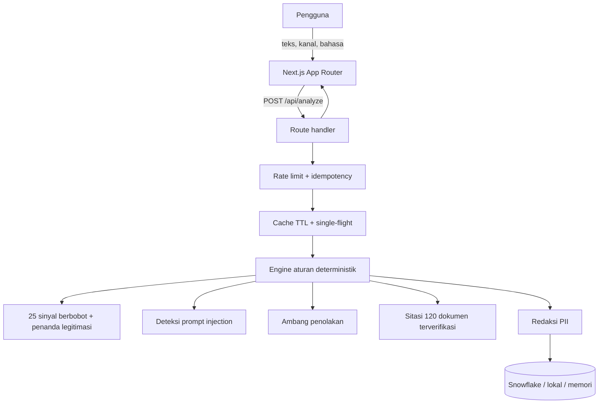

# VetShield 305

**Pemeriksa pesan penipuan dan tutor latihan untuk veteran, lansia, dan keluarga mereka.**

Dibuat untuk **305 Veterans Hackathon, November 2026**.

[](https://github.com/Dikaaff/VetShield-305/actions/workflows/ci.yml)
[](https://github.com/Dikaaff/VetShield-305/actions/workflows/knowledge-links.yml)
[](https://vetshield-305.vercel.app)
[](https://nextjs.org)

> **Live:** https://vetshield-305.vercel.app

---

## Daftar isi

- [Mengapa](#mengapa)
- [Fitur](#fitur)
- [Arsitektur](#arsitektur)
- [Mulai cepat](#mulai-cepat)
- [Variabel lingkungan](#variabel-lingkungan)
- [Perintah](#perintah)
- [API](#api)
- [Knowledge base](#knowledge-base)
- [Dataset dan evaluasi](#dataset-dan-evaluasi)
- [Snowflake](#snowflake-opsional)
- [Privasi dan keselamatan](#privasi-dan-keselamatan)
- [Aksesibilitas](#aksesibilitas)
- [Deployment](#deployment)
- [Struktur proyek](#struktur-proyek)
- [Dokumentasi](#dokumentasi)
- [Batasan](#batasan-yang-diakui)
- [Kontributor](#kontributor)

---

## Mengapa

Penipuan lewat pesan tidak selalu datang dengan ejaan rusak dan huruf kapital. Ia datang
sebagai pemberitahuan bank yang sopan, kode OTP yang asli, atau cucu yang mengganti
nomor. Bagi veteran dan lansia, biaya kesalahannya bisa tabungan, akses akun, atau rasa
malu yang membuat mereka berhenti bertanya.

Alat yang ada sering menjawab dengan kepastian palsu (“aman”, “penipuan”) atau
menjelaskan istilah teknis yang tidak membantu saat panik. VetShield 305 mengambil arah
sebaliknya: **berhenti, pahami tandanya, lakukan tiga langkah aman, dan akui apa yang
tidak bisa diperiksa.**

Dua prinsip yang membedakan proyek ini:

1. **Tidak pernah menjanjikan kepastian.** Setiap hasil menyertakan tingkat kecurigaan,
   batasan, dan kemungkinan salah menilai pesan resmi.
2. **Tetap hidup tanpa cloud.** Engine aturan deterministik berjalan offline; Snowflake
   dan model bahasa adalah lapisan tambahan, bukan ketergantungan tunggal.

## Fitur

| Permukaan | Yang dilakukan |
| --- | --- |
| `/` | Memeriksa pesan: skor 0–100, label, tanda yang terdeteksi, penjelasan kelas 6, tepat 3 langkah aman, sitasi resmi yang bisa dibuka |
| `/practice` | Latihan adaptif per kategori; kesulitan naik setelah 3 jawaban benar, turun setelah 2 salah; umpan balik berisi aturan yang bisa dipakai lagi |
| `/assessment` | Tes 10 soal sebelum dan sesudah latihan, tanpa nama atau email; skor masuk ke dashboard |
| `/dashboard` | Pemakaian, sebaran hasil, akurasi per kategori, tingkat penolakan, latensi, dan panel pembelajaran yang menahan klaim bila n < 20 |

Kemampuan inti:

- Deteksi **prompt injection** dan penolakan menilai pesan yang memerintahkan mesin.
- **Penolakan saat bukti kurang**: pesan pendek tanpa sinyal kuat menjadi
  `insufficient_info`.
- **Redaksi PII** sebelum penyimpanan; teks mentah tidak pernah disimpan.
- **Dua adapter penyimpanan**: Snowflake SQL API dan penyimpanan lokal/memori.
- **120 sitasi terverifikasi** dari 40 sumber resmi, dalam tiga bahasa.
- API terdokumentasi OpenAPI 3.1.

## Arsitektur



- **Engine** selalu menjawab, bahkan tanpa internet, kredensial, atau kredit cloud.
- **Snowflake** hanya menambah persistensi; kegagalan tulis tidak pernah menggagalkan
  pemeriksaan.
- **Vercel** menjalankan aplikasi tanpa variabel wajib; di serverless penyimpanan lokal
  beralih ke memori dan dashboard menandainya `source=memory`.

Detail keputusan ada di [`docs/02-architecture.md`](docs/02-architecture.md).

## Mulai cepat

Prasyarat: **Node.js 22+** dan npm.

```bash
git clone https://github.com/Dikaaff/VetShield-305.git
cd VetShield-305
npm install
npm run dev
```

Buka http://localhost:3000. Tanpa file `.env`, aplikasi berjalan penuh dengan engine
deterministik dan penyimpanan lokal di `.data/` (di-ignore oleh Git).

Build produksi:

```bash
npm run typecheck
npm run build
npm start
```

## Variabel lingkungan

Semua opsional. Salin `.env.example` bila ingin mengubah perilaku.

| Variabel | Default | Fungsi |
| --- | --- | --- |
| `PII_HASH_SALT` | salt pengembangan | Salt hash teks sebelum disimpan. **Wajib diganti di produksi.** |
| `RETENTION_DAYS` | `7` | Retensi cuplikan teredaksi pada penyimpanan lokal |
| `MIN_CONFIDENCE` | `0.4` | Di bawah nilai ini hasil menjadi `insufficient_info` |
| `CACHE_TTL` | `600` | TTL cache hasil (detik) |
| `ANALYZE_RATE_LIMIT` | `30` | Batas analisis per menit per IP |
| `PREPOST_RATE_LIMIT` | `60` | Batas kiriman skor pre/post per menit per IP |
| `SNOWFLAKE_ACCOUNT` | — | Akun Snowflake |
| `SNOWFLAKE_USER` | — | User layanan |
| `SNOWFLAKE_TOKEN` | — | Programmatic access token |
| `SNOWFLAKE_WAREHOUSE` | `COMPUTE_WH` | Warehouse |
| `SNOWFLAKE_DATABASE` | `VETSHIELD_DB` | Database |
| `SNOWFLAKE_SCHEMA` | `APP` | Schema |
| `SNOWFLAKE_ROLE` | — | Role (opsional) |
| `SNOWFLAKE_HOST` | — | Hanya untuk emulator pengujian; produksi memakai host akun |

## Perintah

| Perintah | Kegunaan |
| --- | --- |
| `npm run dev` | Server pengembangan |
| `npm run build` / `npm start` | Build dan jalankan produksi |
| `npm run typecheck` | TypeScript strict tanpa emit |
| `npm run data:scenarios` | Regenerasi 500 skenario sintetis (deterministik) |
| `npm run eval` | Evaluasi pada split uji 30% (butuh server berjalan) |
| `npm run verify:knowledge` | Periksa 40 URL sumber secara HTTP |
| `npm run data:knowledge` | Verifikasi + generate 120 dokumen |
| `npm run check:knowledge` | Integritas knowledge base tanpa jaringan (dipakai CI) |
| `npm run mock:snowflake` | Emulator SQL API untuk menguji adapter Snowflake |

Evaluasi lokal:

```bash
ANALYZE_RATE_LIMIT=1000 npx next start -p 3111
API_BASE=http://localhost:3111 npm run eval
```

## API

| Endpoint | Metode | Ringkas |
| --- | --- | --- |
| `/api/analyze` | POST | Analisis pesan; `Idempotency-Key` didukung |
| `/api/practice/next` | POST | Soal latihan berikutnya |
| `/api/practice/answer` | POST | Kirim jawaban, terima umpan balik |
| `/api/dashboard/summary` | GET | Agregat `7d`, `30d`, atau `all` |
| `/api/prepost` | POST | Catat skor tes sebelum/sesudah |
| `/api/health` | GET | Status layanan, knowledge, dan Snowflake |

Kontrak lengkap: [`docs/04-openapi.yaml`](docs/04-openapi.yaml). Error selalu berbentuk
`{ "error": { "code", "message" } }`.

Contoh:

```bash
curl -X POST https://vetshield-305.vercel.app/api/analyze \
  -H "Content-Type: application/json" \
  -d '{"text":"Akun Anda akan diblokir. Kirim kode OTP sekarang.","language":"id"}'
```

## Knowledge base

- **40 sumber resmi** — FTC, CISA, IC3, SSA, VA, IRS, CFPB, USA.gov, NCSC, Scamwatch,
  Cyber.gov.au, FCA, Interpol, Europol, OJK, Bank Indonesia, Komdigi, BSSN, Google,
  Microsoft, dan lainnya.
- **3 bahasa per sumber** → **120 dokumen**.
- Setiap URL diperiksa; hanya sumber **HTTP 200–399** yang dipakai untuk sitasi.
- UI menampilkan tautan **“Buka sumber resmi (terverifikasi)”**.
- CI memeriksa integritas korpus; workflow mingguan memeriksa ulang seluruh URL.

```bash
npm run verify:knowledge && npm run data:knowledge
```

Rincian, pipeline, dan batasannya: [`docs/07-knowledge.md`](docs/07-knowledge.md).

## Dataset dan evaluasi

Korpus sintetis **500 item**: 300 penipuan / 200 wajar, 60/30/10 id/en/es, 60 item
adversarial (30 penipuan yang terlihat sangat wajar, 30 pesan wajar yang terlihat seperti
penipuan), dan tiga tingkat kesulitan. Tidak ada pesan nyata atau data pribadi.

Split uji 30% ditentukan oleh hash id, bukan dipilih tangan. Hasil pada 146 item uji:

| Metrik | VetShield | Baseline kata kunci |
| --- | ---: | ---: |
| Akurasi | **77,4%** | 57,5% |
| Presisi penipuan | 93,3% | 68,3% |
| Recall penipuan | 65,9% | 50,6% |
| F1 penipuan | 77,2% | — |
| Alarm palsu | 6,6% | — |
| Latensi p50 / p95 | < 1 ms / 1 ms | — |

**Baca angka ini dengan benar:** data sintetis, template dan aturan dibuat oleh penulis
yang sama, sehingga evaluasi bersifat sirkular. Ini ukuran regresi dan konsistensi,
bukan bukti performa dunia nyata. Metodologi lengkap:
[`docs/11-kaggle-eval.md`](docs/11-kaggle-eval.md).

## Snowflake (opsional)

1. Jalankan [`snowflake/schema.sql`](snowflake/schema.sql) — 8 tabel, clustering, dan task
   pembersihan cuplikan setelah 7 hari.
2. Isi variabel `SNOWFLAKE_*`.
3. Buka `/api/health`; `snowflake.configured` harus `true`.
4. Periksa `/api/dashboard/summary`; `source` harus `snowflake`.

Jika warehouse dingin, kredit habis, atau kredensial salah, penulisan gagal secara senyap
dan dashboard jatuh ke penyimpanan lokal. Pemeriksaan pesan tidak pernah bergantung pada
Snowflake.

Adapter diuji tanpa akun nyata memakai emulator:

```bash
npm run mock:snowflake
SNOWFLAKE_ACCOUNT=mock SNOWFLAKE_USER=test SNOWFLAKE_TOKEN=test \
SNOWFLAKE_HOST=http://localhost:3222 npx next start -p 3112
```

Uji ini menemukan bug normalisasi kolom (huruf besar vs kecil), yang sudah diperbaiki.
Fallback juga diuji dengan mematikan emulator saat server hidup: dashboard tetap 200
dengan `source=local`, analisis tetap 200, kegagalan tulis tercatat.

## Privasi dan keselamatan

- Teks pesan **tidak pernah disimpan**. Yang disimpan: hash SHA-256 bersalt dan cuplikan
  maksimal 160 karakter yang sudah disamarkan.
- Retensi default **7 hari** (task Snowflake; pemangkasan lokal otomatis).
- Penyimpanan bersifat **opt-out** di formulir.
- Rate limit per IP; input maksimal 4.000 karakter; header keamanan dasar.
- Tidak ada nasihat hukum, medis, atau keuangan. Permintaan seperti itu ditolak dan
  diarahkan ke saluran resmi.
- Prompt injection diperlakukan sebagai data, bukan instruksi.

Risiko yang belum tertutup dan rencana perbaikannya ada di
[`docs/13-audit.md`](docs/13-audit.md).

## Aksesibilitas

- Ukuran teks dasar 17px, kontras minimal 4,5:1, fokus terlihat jelas.
- `aria-live` pada hasil analisis dan umpan balik latihan.
- Skip link, navigasi dengan keyboard, label formulir eksplisit.
- Menghormati `prefers-reduced-motion`.
- Bahasa sederhana, tanpa menyalahkan korban.

Belum diuji dengan pengguna pembaca layar; itu tercatat sebagai batasan.

## Deployment

Produksi: **https://vetshield-305.vercel.app**

[](https://vercel.com/new/clone?repository-url=https://github.com/Dikaaff/VetShield-305)

Langkah manual:

```bash
npm i -g vercel
vercel link --project vetshield-305
vercel env add PII_HASH_SALT production
vercel --prod
```

Catatan produksi:

- `PII_HASH_SALT` sudah diset sebagai secret produksi.
- Tanpa kredensial Snowflake, penyimpanan di Vercel memakai memori proses; dashboard
  menampilkan `source=memory` dan riwayat hilang saat instance didaur ulang.
- Korpus latihan dibundel ke fungsi serverless lewat `outputFileTracingIncludes`.
- Next.js dipin ke **15.5.29** karena versi 15.5.4 diblokir Vercel akibat CVE.

## Struktur proyek

```text
.github/workflows/   CI dan pemeriksaan tautan knowledge mingguan
src/app/             halaman dan route handler
src/components/      UI pemeriksa, latihan, assessment, dashboard
src/lib/             engine, PII, store, Snowflake, practice, knowledge
data/                500 skenario, katalog 40 sumber, hasil verifikasi, hasil eval
scripts/             generator, verifikasi, build knowledge, mock Snowflake
snowflake/           skema warehouse 8 tabel
prompts/             prompt assess.v1.0 dengan aturan dan contoh
docs/                constitution, PRD, arsitektur, dataset, audit, writeup, demo
```

## Dokumentasi

| Dokumen | Isi |
| --- | --- |
| [`docs/00-constitution.md`](docs/00-constitution.md) | Sembilan pasal yang mengikat produk |
| [`docs/01-prd.md`](docs/01-prd.md) | Masalah, persona, kebutuhan F1–F11, metrik |
| [`docs/02-architecture.md`](docs/02-architecture.md) | Alur, modul, skoring, penyimpanan |
| [`docs/03-dataset.md`](docs/03-dataset.md) | Skema korpus, split, batasan sintetis |
| [`docs/04-openapi.yaml`](docs/04-openapi.yaml) | Kontrak API |
| [`docs/07-knowledge.md`](docs/07-knowledge.md) | Pipeline grounding dan verifikasi URL |
| [`docs/11-kaggle-eval.md`](docs/11-kaggle-eval.md) | Metodologi dan hasil evaluasi |
| [`docs/12-writeup.md`](docs/12-writeup.md) | Writeup Devpost dan cerita produk |
| [`docs/13-audit.md`](docs/13-audit.md) | Temuan keamanan, privasi, dan kejujuran |
| [`docs/14-demo-script.md`](docs/14-demo-script.md) | Skrip demo 90 detik dan jalur cadangan |
| [`prompts/assess.v1.0.md`](prompts/assess.v1.0.md) | Prompt produksi (belum diaktifkan) |

## Batasan yang diakui

1. Evaluasi memakai data sintetis dan bersifat sirkular.
2. Recall penipuan 65,9%: sekitar sepertiga penipuan sulit masih lolos.
3. Knowledge base 120 dokumen, tetapi halaman sumber bisa berubah setelah verifikasi.
4. Cortex Search dan Gemma belum diaktifkan; `model_used` tetap `vetshield-rules-v1`.
5. Sesi latihan disimpan di memori dan hilang saat server restart.
6. Dashboard dan `/api/prepost` belum punya autentikasi.
7. Klaim pre/post baru layak setelah minimal 20 responden; data demo bukan studi
   lapangan dan tidak boleh dikutip sebagai bukti efektivitas.
8. Rate limit dan idempotensi bersifat per instance.

## Kontributor

**Dikaaff** — ide, implementasi, data, dan dokumentasi.

Kontribusi terbuka lewat issue atau pull request. Sebelum mengirim PR, jalankan:

```bash
npm run typecheck && npm run build && npm run check:knowledge
```

Jangan menambahkan pesan nyata, data pribadi, atau URL sumber yang belum diverifikasi ke
repositori ini.
